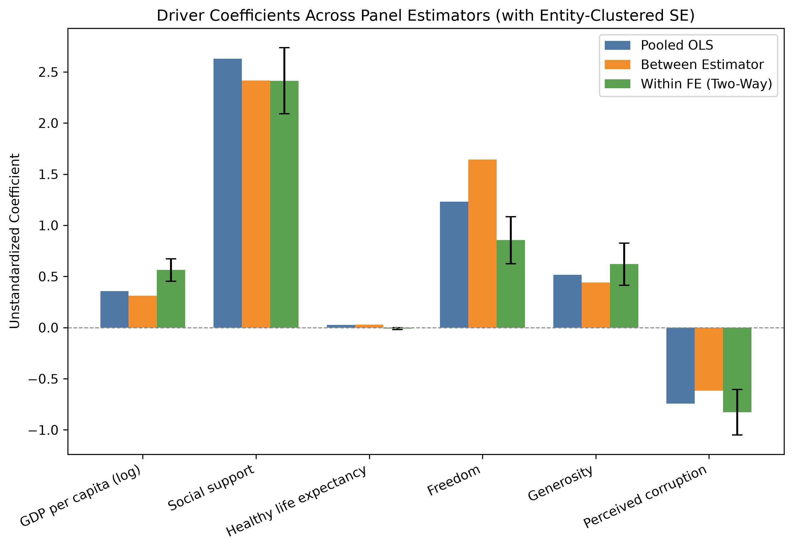
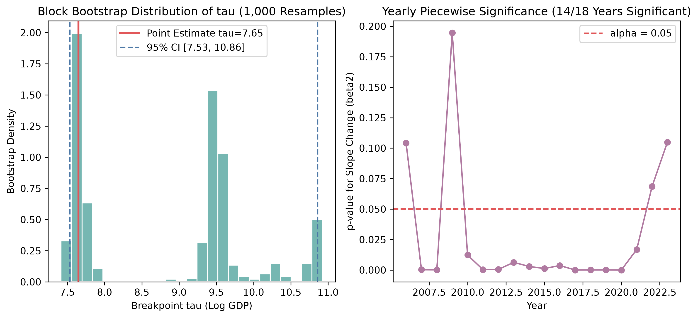
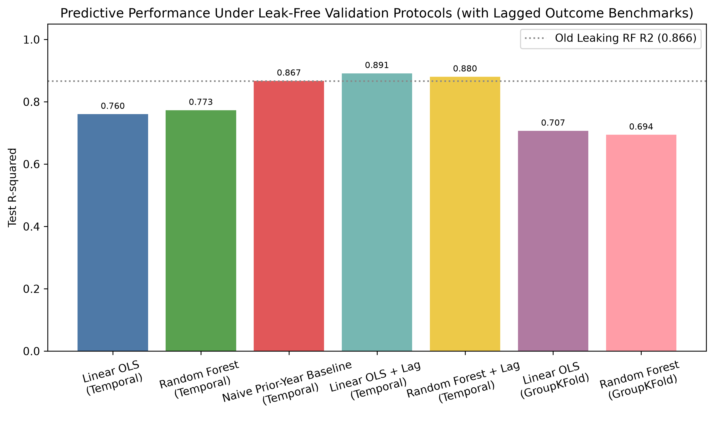
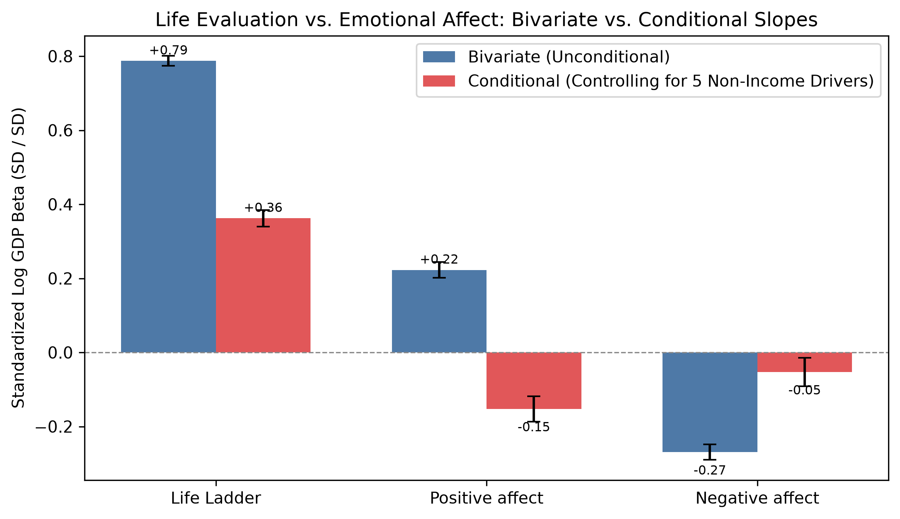
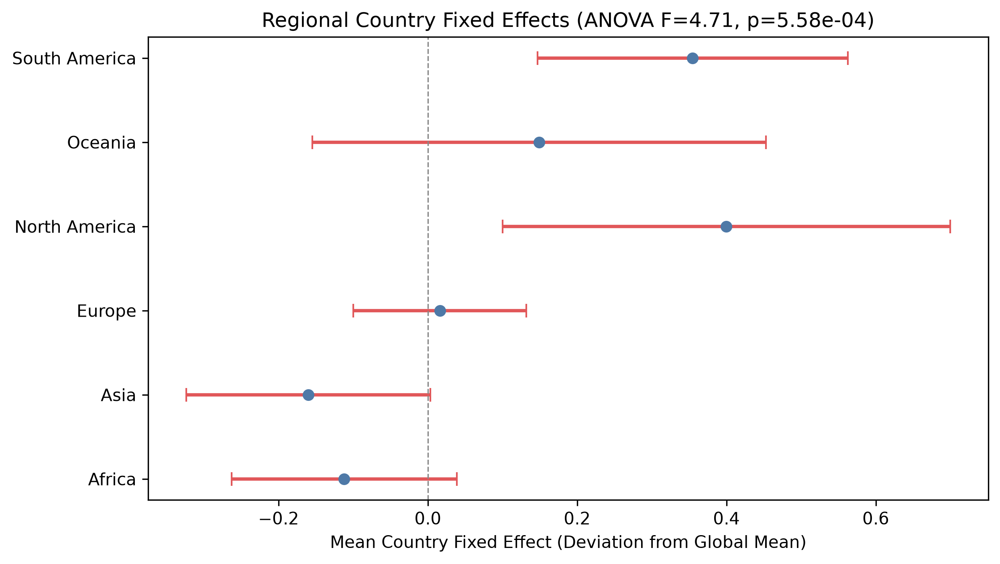

# Econometric Panel Decomposition, Structural Breakpoints, and Predictive Generalization in the World Happiness Report (2005–2023)

**Authors:**  
- Pandiri Ananya (IIT2023023)  
- Peer Singh (IIT2023197)  
- Adithya Chavali (IEC2023023)  

**Supervisor:** Dr. Ramesh Kumar Bhukya  
**Institution:** Indian Institute of Information Technology, Allahabad  
**Course:** Science of Happiness (Independent Self-Study)  
**Date:** November 2026  

---

## 1. Abstract
This study provides an econometric and machine learning re-evaluation of the World Happiness Report panel (2005–2023), covering 165 nations. Motivated by contradictory claims regarding the Easterlin Paradox, income satiation, and predictive driver importance, we implement panel fixed effects, continuous piecewise models, and leak-free validation protocols. Regressing Cantril Life Ladder on Log GDP per capita alone yields an Easterlin ratio of cross-sectional between-country slope (raw: $\beta = 0.7454$ ladder points per log unit) to longitudinal within-country slope (raw: $\beta = 0.7229$ ladder points per log unit) of 1.0311. A bivariate Mundlak specification fails to reject equality between these slopes ($p = 0.7360$), indicating no statistically detectable difference, though the within-country estimate is imprecise ($95\% \text{ CI: } [0.4236, 1.0222]$). In multivariate models, controlling for non-income drivers reduces the between-country income slope to raw $\beta = 0.3106$ ladder points per log unit via cross-sectional collinearity with social institutions. Piecewise regression reveals structural fragility: the Akaike Information Criterion surface is bimodal across country-cluster bootstrap panels, yielding an identification interval spanning $\tau \in [7.5319, 10.8600]$ ($\approx \$1,867$ to $\$52,052$). The sample AIC minimum ($\tau = 7.648$) is identified off a thin tail ($9.99\%$ of observations) with an implausible negative lower slope (raw $\beta_1 = -0.2811$ ladder points per log unit, $p = 0.0600$), whereas the bootstrap median ($\tau = 9.405$) reveals accelerated positive returns (raw $\beta_1 = 0.2349$ ladder points per log unit, $p = 0.0045$; slope above $= 0.5337$ ladder points per log unit, $p < 0.0001$). Under forward-chaining temporal splits (2019–2023), contemporaneous drivers explain $R^2 = 0.7604$, but adding lagged national happiness increases performance to $R^2 = 0.8913$ ($F = 28.42, p < 10^{-20}$), demonstrating substantial historical persistence in national well-being.

---

## 2. Introduction and Motivation
Subjective well-being research frequently informs national policy debates, multilateral development priorities, and economic growth targets. For decades, the field has been animated by two foundational debates:
1. **The Easterlin Paradox**: Whether economic expansion yields enduring improvements in national life satisfaction, or whether hedonic adaptation and social comparison nullify aggregate gains over time.
2. **Income Satiation**: Whether the marginal utility of income diminishes to zero beyond a critical developmental threshold.

Prior empirical presentations often struggled with methodological vulnerabilities. Bivariate cross-sectional correlations were routinely conflated with longitudinal growth elasticities; pooled Ordinary Least Squares (OLS) models ignored country-level clustering and time trends; machine learning models reported inflated predictive accuracy due to random-split panel leakage; and piecewise regression thresholds were asserted without sensitivity checks against sample composition.

This report establishes an econometric assessment of the World Happiness Report (WHR) panel dataset (2005–2023). By decomposing variation into within-country and between-country components, testing the stability of structural thresholds, implementing clustered standard errors, and auditing cross-validation protocols, we provide an empirical accounting of what the data statistically support and where precision limits causal inference.

---

## 3. Literature Survey

The empirical framework of this investigation is grounded in foundational studies from the well-being literature and the World Happiness Report:

| S.No | Publication Details | Summary (Work / Limitation) | Conclusion |
|:---:|:---|:---|:---|
| 1 | **Easterlin, R. A. (1974)**. *Does economic growth improve the human lot? Some empirical evidence*. In Nations and Households in Economic Growth (pp. 89–125). Academic Press. | Examined time-series of national happiness in post-war US and international cross-sections. Argued that despite substantial GDP growth, average subjective well-being remained flat due to hedonic adaptation and relative income comparison. **Limitation**: Based on sparse historical time series and bivariate comparisons. | Growth does not raise long-term subjective well-being; relative status dominates absolute economic gains. |
| 2 | **Stevenson, B., & Wolfers, J. (2008)**. *Economic growth and subjective well-being: Reassessing the Easterlin paradox*. Brookings Papers on Economic Activity, 2008(1), 1–87. | Re-analyzed multi-decade global surveys (Gallup World Poll, World Values Survey). Re-estimated income-happiness slopes within and between countries, finding positive, log-linear relationships across both developing and developed nations. **Limitation**: Relied heavily on repeated cross-sections with short panel dimensions. | Rejects the Easterlin claim; economic growth generates measurable increases in subjective well-being with no evidence of satiation. |
| 3 | **Kahneman, D., & Deaton, A. (2010)**. *High income improves evaluation of life but not emotional well-being*. PNAS, 107(38), 16489–16493. | Analyzed 450,000 US responses, separating evaluative well-being (Cantril Ladder) from emotional affect (positive/negative daily mood). Found daily emotional affect plateaus near \$75,000, while life evaluation continues rising log-linearly. **Limitation**: US cross-sectional household survey, not international macro panel. | Income satiation applies to day-to-day emotional affect, whereas cognitive life evaluation does not exhibit a ceiling. |
| 4 | **Killingsworth, M. A. (2021)**. *Experienced well-being rises with income, even above \$75,000 per year*. PNAS, 118(4), e2016976118. | Deployed smartphone experience sampling across 33,391 US adults (1.7M reports), tracking real-time affect. Found experienced well-being continues rising above \$75,000 without an absolute plateau. **Limitation**: Smartphone sample biased toward tech-literate populations; US-centric. | Questioned the \$75,000 emotional affect threshold; concluded that all forms of well-being continue rising with income. |
| 5 | **Killingsworth, M. A., Kahneman, D., & Mellers, B. (2023)**. *Income and emotional well-being: A conflict resolved*. PNAS, 120(10), e2208661120. | Conducted an adversarial collaboration re-analyzing experience sampling data. Identified that happiness increases systematically with income for the majority, while a plateau occurs exclusively for an unhappy minority ($15–20\%$) suffering non-financial distress. **Limitation**: Individual-level microdata; cannot be mapped directly to cross-national macro aggregates. | Satiation is heterogeneous: emotional well-being plateaus only for the least happy quantile, while expanding for the broader population. |
| 6 | **Diener, E., Suh, E. M., Lucas, R. E., & Smith, H. L. (1999)**. *Subjective well-being: Three decades of progress*. Psychological Bulletin, 125(2), 276–302. | Narrative review synthesizing three decades of research across demographic, economic, and psychological dimensions. Found that economic factors explain only part of well-being variance, with social relationships, personality traits, and psychological coping mechanisms explaining substantial additional variation. **Limitation**: Broad qualitative review summarizing disparate cross-sectional and longitudinal studies without unified econometric panel modeling. | Economic factors account for only a portion of well-being; social connections, psychological factors, and adaptation play substantial roles. |
| 7 | **Helliwell, J. F., Layard, R., Sachs, J. D., De Neve, J.-E., Aknin, L. B., & Wang, S. (2024)**. *World Happiness Report 2024*. University of Oxford: Wellbeing Research Centre. | Flagship international survey report tracking national subjective well-being (Cantril Life Ladder) across 140+ countries. Uses pooled cross-sectional regressions to decompose national happiness into six explanatory factors. **Limitation**: Relies on pooled cross-sectional models without accounting for country fixed effects, unobserved heterogeneity, or dynamic panel persistence. | Evaluative life satisfaction varies substantially across countries and is correlated with income, social support, health, freedom, generosity, and corruption perceptions. |

---

## 4. Research Gap and Problem Statement

Despite decades of scholarship, cross-national analytical applications frequently suffer from four recurring methodological failures:
1. **Total vs. Partial Slope Conflation**: Estimating a multivariate regression with controls (e.g., social support, corruption) and comparing between- and within-country income coefficients as an "Easterlin test", ignoring that collinear cross-sectional controls absorb between-country income variation.
2. **Structural Fragility of Piecewise Breakpoints**: Reporting an empirical breakpoint ($\tau$) without evaluating whether it partitions the data evenly or overfits an unstable, sparse tail.
3. **Information Leakage in Validation**: Partitioning panel rows randomly across train/test splits, allowing past and future observations from the same country to leak across sets, which inflates predictive accuracy.
4. **Failure to Benchmark Against Longitudinal Persistence**: Evaluating complex models against zero-information baselines rather than naive historical persistence (predicting last year's happiness score).

**Problem Statement**: To resolve these vulnerabilities, we construct an end-to-end reproducible analytical package that estimates unconditioned bivariate panel models, re-centers country fixed effects, tests breakpoint parameter sensitivity, and validates leak-free machine learning baselines across the complete 2005–2023 WHR panel.

---

## 5. Dataset Description and Attrition Analysis

The source dataset is the official World Happiness Report 2024 update ([`happiscope_master.csv`](file:///Users/srinivasch/Desktop/Happiscope/data/happiscope_master.csv)), comprising $N = 2,363$ country-year observations across 165 nations from 2005 to 2023. The dependent variable is the **Cantril Life Ladder** (evaluative well-being on an 11-point scale from 0 to 10). The six core explanatory drivers are:
- `Log GDP per capita`: Purchasing-power-adjusted economic output in natural logarithms.
- `Social support`: National average response to having someone to count on in times of trouble.
- `Healthy life expectancy at birth`: WHO-derived healthy life expectancy in years.
- `Freedom to make life choices`: National average binary response regarding perceived autonomy.
- `Generosity`: Residual of national charitable donation response regressed on Log GDP.
- `Perceptions of corruption`: Average perception of institutional and business corruption.

### Complete-Case Attrition and Non-Random Missingness
Enforcing complete-case analysis across all six explanatory variables and the Cantril Life Ladder drops 260 observations ($11.00\%$), yielding an estimation sample of $N = 2,103$ across 155 countries. After complete-case filtering, the effective empirical modelling panel spans 2006–2023 ($N = 2,102$), with 2005 contributing a single isolated observation (Canada, $N=1$). Full annual sample distributions are detailed in Appendix Table A4:
- **Geographic Concentration**: Missingness is systematically concentrated in Asia, which accounts for 176 of the 260 dropped observations ($67.69\%$).
- **Economic Profile Differences**: The dropped sample is substantially wealthier than the retained sample (mean Log GDP of $9.81$ vs. $9.35$) and reports higher baseline life satisfaction (mean Life Ladder of $5.63$ vs. $5.47$). Missingness is driven by non-reporting of corruption and charitable giving indicators in Gulf Cooperation Council economies and specific Asian nations. Consequently, complete-case regressions slightly under-represent high-income Asian institutional profiles.

---

## 6. Methodology

### 6.1 Panel Econometric Estimators
To separate cross-sectional from longitudinal dynamics, we estimate four complementary specifications:
1. **Pooled OLS**: Standard pooled regression ignoring entity and time grouping.
2. **Between Estimator**: Regresses country means ($\bar{Y}_i$) on country-mean regressors ($\bar{X}_i$), capturing long-run cross-sectional differences across $N = 155$ nations.
3. **Within Estimator (Country FE)**: Implemented via within-entity demeaning with cluster-robust standard errors at the country level.
4. **Two-Way Fixed Effects**: Demeans across both countries and survey years, removing shared global secular trends (e.g., macroeconomic shocks).

### 6.2 The Formal Mundlak Specification
To formally test slope equality, we estimate the Mundlak equation:
$$\text{Life Ladder}_{it} = \alpha + \beta_{\text{within}} X_{it} + \gamma \bar{X}_i + \epsilon_{it}$$
where $\gamma = \beta_{\text{between}} - \beta_{\text{within}}$. The cluster-robust $t$-statistic on $\gamma$ provides the exact test of slope divergence ($H_0: \gamma = 0$).

### 6.3 Continuous Piecewise Regression and Block Bootstrap
We model non-linear income returns using a continuous piecewise hinge:
$$\text{Life Ladder}_{it} = \alpha + \beta_1 X_{it} + \beta_2 \max(0, X_{it} - \tau) + \mathbf{Z}_{it}\boldsymbol{\delta} + \epsilon_{it}$$
where $\mathbf{Z}_{it}$ controls for the remaining five WHR drivers. Because panel observations within nations share serial correlation, standard row-wise bootstrapping destroys error covariance. We implement a **whole-country block bootstrap** (1,000 resamples), sampling entire country trajectories with replacement.

### 6.4 Leak-Free Predictive Validation
To eliminate panel leakage, models are benchmarked across two leak-free designs:
- **Forward-Chaining Temporal Split**: Train on historical panel data ($\le 2018$, $N=1,353$); test on out-of-sample future years ($2019–2023$, $N=595$).
- **GroupKFold Cross-Validation**: 5-fold split grouped strictly by country, evaluating cross-national generalization to entirely unseen nations.
- **Persistence Benchmarks**: Compares machine learning and OLS models against naive prior-year prediction ($Y_{i, t-1}$) on matched samples.

### 6.5 Reporting Units: Raw vs. Standardized Coefficients
Throughout this report, regression slopes are explicitly designated as either **raw** or **standardized** to preserve analytical clarity:
1. **Raw coefficients (ladder points per log unit of GDP per capita)**: Used in all panel econometric specifications (Pooled OLS, Between Estimator, Within Fixed Effects, and Piecewise Regressions). These retain the natural 0–10 metric of the Cantril Life Ladder, directly answering how a 1-unit increase in $\ln(\text{GDP})$ (approximately a $2.72$-fold increase in real national income per capita) affects average national life satisfaction.
2. **Standardized coefficients (SD of outcome per SD of predictor)**: Used when comparing relative feature importances across disparate physical dimensions (e.g., life expectancy in years vs. binary proportions) and when benchmarking cognitive life evaluation against daily emotional affect (Kahneman & Deaton models). Standardizing variables allows scale-free comparability across outcomes with different baseline variances. For bivariate regressions, the standardized slope equals Pearson's correlation $r$, mapping directly to variance explained ($R^2 = \beta_{\text{std}}^2$).
Every coefficient in the text and tables is explicitly tagged with its operational unit.

---

## 7. Results: Eight Empirical Findings

### Finding 1: Cross-Sectional vs. Longitudinal Income Elasticity (The Easterlin Test)
In the unconditioned bivariate specification (`Life Ladder` regressed on `Log GDP per capita` alone), the between-country cross-sectional slope is raw $\beta_{\text{between}} = 0.7454$ ladder points per log unit ($SE = 0.0398, p < 0.0001, 95\% \text{ CI: } [0.6668, 0.8240]$). The within-country longitudinal slope is raw $\beta_{\text{within}} = 0.7229$ ladder points per log unit ($SE = 0.1526, p = 2.32 \times 10^{-6}, 95\% \text{ CI: } [0.4236, 1.0222]$), yielding an Easterlin point ratio of **`1.0311`**. 

Estimating the bivariate Mundlak specification yields $\gamma = \beta_{\text{between}} - \beta_{\text{within}} = +0.0533$ ladder points per log unit ($SE = 0.1582, z = 0.337, p = 0.7360$; Wald $\chi^2(1) = 0.1137$). **We find no statistically detectable difference between the between-country and within-country income slopes ($p = 0.7360$), though the within-country estimate is imprecise**. The data are consistent with both moderate and strong longitudinal gains; the evidence does not license claiming that Easterlin's paradox is rejected. Controlling for secular global growth via Two-Way Fixed Effects yields raw $\beta_{\text{within, twoway}} = 0.7175$ ladder points per log unit ($SE = 0.1807, 95\% \text{ CI: } [0.3631, 1.0719]$), producing a ratio of **`1.0388`**.

Because survey year 2005 contributes a single observation ($N=1$, Canada), defining year effects relative to 2005 is degenerate. We therefore report grand-mean-centered year effects ($\sum_{t=2005}^{2023} \alpha_t^* = 0$, with offset $-0.1602$). The 18 year fixed effects for 2006–2023 are jointly highly statistically significant ($\chi^2(18) = 1,075.24, p = 5.75 \times 10^{-217}$). Fitting an Ordinary Least Squares linear trend across the centered year effects for 2006–2023 yields a slope of $+0.001467$ ladder points per year ($SE = 0.003122, t = 0.4697, p = 0.6449, R^2 = 0.0136, 95\% \text{ CI: } [-0.005153, +0.008086]$). Once country fixed effects and Log GDP per capita are controlled for, global well-being shows a statistically flat trend ($p = 0.6449$), indicating neither secular progress nor secular decline over this 18-year period; year effects reflect cyclical macroeconomic and geopolitical fluctuations rather than a persistent directional drift.

### Finding 2: Conditional Multivariate Panel Slopes & Institutional Absorption
When all six WHR drivers are entered simultaneously into panel regressions, the between-country income coefficient drops sharply to raw $\beta_{\text{between}} = 0.3106$ ladder points per log unit, while the within-country coefficient is raw $\beta_{\text{within}} = 0.5626$ ladder points per log unit ($SE = 0.1098, p = 3.28 \times 10^{-7}$). The multivariate Mundlak Wald test rejects slope equality jointly across all six drivers ($\chi^2(6) = 16.7814, p = 0.0101$) and for Log GDP specifically ($\chi^2(1) = 4.9606, p = 0.0259$). This divergence occurs because cross-sectional differences in income are heavily collinear with country-mean social support ($\beta = 2.4157$ ladder points per unit) and life expectancy ($\beta = 0.0305$ ladder points per year, $\chi^2=7.87, p=0.0050$), which absorb between-country income variation.

### Finding 3: Breakpoint Fragility & Accelerated Non-Satiation
Evaluating the multivariate piecewise model reveals severe sensitivity to threshold selection (*Figure 2*):

| Specification | Threshold $\tau$ | $N_{\text{below}}$ (%) | $N_{\text{above}}$ (%) | Slope Below ($\beta_1$, raw) | Slope Change ($\beta_2$, raw) | Slope Above ($\beta_1 + \beta_2$, raw) | $R^2$ | AIC |
|:---|:---:|:---:|:---:|:---:|:---:|:---:|:---:|:---:|
| **Sample AIC Minimum** | 7.648 | 210 (9.99%) | 1,893 (90.01%) | -0.2811 ($p=0.0600$) | +0.7026 ($p=4.26 \times 10^{-5}$) | +0.4215 ($p=2.96 \times 10^{-9}$) | 0.7590 | 3527.16 |
| **Substantively Preferred** | 9.405 | 986 (46.89%) | 1,117 (53.11%) | +0.2349 ($p=0.0045$) | +0.2988 ($p=0.0205$) | +0.5337 ($p=1.23 \times 10^{-7}$) | 0.7581 | 3534.97 |

The 1,000 country-block bootstrap resamples produce a bimodal AIC distribution spanning a 95% confidence interval of $\tau \in [7.5319, 10.8600]$ ($\approx \$1,867$ to $\$52,052$). The lower mode ($\tau = 7.648$) is identified off a thin tail ($9.99\%$ of panel rows) and estimates an economically implausible negative lower slope (raw $\beta_1 = -0.2811$ ladder points per log unit), which is statistically indistinguishable from zero ($p = 0.0600$) and represents a small-sample tail artifact. The substantively preferred threshold is $\tau = 9.405$ (the bootstrap median), where the lower slope is positive (raw $\beta_1 = +0.2349$ ladder points per log unit, $p = 0.0045$) and the upper slope accelerates to raw $+0.5337$ ladder points per log unit ($p < 0.0001$). Across both specifications, **we find no evidence of income satiation; rather, the income-happiness relationship accelerates above the breakpoint**.

### Finding 4: Temporal Generalization vs. Lagged Outcome Persistence
On the forward-chaining temporal split (Train $\le 2018$; Test $2019–2023$, matched $N = 595$), models trained only on contemporaneous WHR drivers achieve test $R^2 = 0.7604$ (Linear OLS, $RMSE = 0.5468$) and $R^2 = 0.7731$ (Random Forest, $RMSE = 0.5321$). The naive prior-year persistence baseline achieves $R^2 = 0.8671$ ($RMSE = 0.4072$). 

When augmented with the lagged outcome ($Y_{i, t-1}$), Linear OLS achieves $R^2 = 0.8913$ ($RMSE = 0.3682$) and Random Forest achieves $R^2 = 0.8804$ ($RMSE = 0.3864$). A nested model $F$-test proves that adding the six contemporaneous drivers to the lagged outcome model yields a statistically significant improvement ($F(6, 587) = 28.4171, p < 10^{-20}$), reducing test sum of squared errors from $96.15$ to $74.51$.

### Finding 5: Cross-Country Out-of-Sample Generalization (GroupKFold)
Under 5-fold cross-validation grouped strictly by country ($N = 2,103$), predictive performance degrades substantially: Linear OLS achieves mean test $R^2 = 0.7065$ ($RMSE = 0.5850$), while Random Forest achieves mean test $R^2 = 0.6940$ ($RMSE = 0.6068$). This gap demonstrates that standard random-split cross-validation ($R^2 = 0.8663$) suffered severe information leakage by memorizing country-specific baseline happiness.

### Finding 6: Evaluative Life Satisfaction vs. Emotional Affect
To examine whether national economic output operates differently on cognitive life evaluation versus day-to-day emotional affect (Kahneman & Deaton, 2010), we estimate standardized regressions where both outcomes and predictors are $z$-scored across both bivariate (unconditional) and multivariate (conditional on the remaining five WHR drivers) specifications (*Figure 4*):

| Outcome Metric | Outcome Dimension | Bivariate (Unconditional) Std $\beta$ | Conditional (5 Controls) Std $\beta$ | Conditional Model $R^2$ | Sample $N$ |
|---|---|---|---|---|---|
| **Cantril Life Ladder** | Evaluative Well-Being | **$+0.7836$** ($SE = 0.0129, p < 0.0001$) | **$+0.3623$** ($SE = 0.0226, p = 8.69 \times 10^{-55}$) | $0.7532$ | $2,103$ |
| **Positive Affect** | Daily Positive Mood | **$+0.2309$** ($SE = 0.0202, p = 2.46 \times 10^{-29}$) | **$-0.1523$** ($SE = 0.0344, p = 1.02 \times 10^{-5}$) | $0.4274$ | $2,098$ |
| **Negative Affect** | Daily Distress / Worry | **$-0.2607$** ($SE = 0.0201, p = 2.46 \times 10^{-37}$) | **$-0.0527$** ($SE = 0.0383, p = 0.1683$) | $0.2906$ | $2,102$ |

*(Note: On the restricted complete-case estimation samples, bivariate standardized slopes are $+0.7873$ for Life Ladder, $+0.2226$ for Positive affect, and $-0.2691$ for Negative affect).*

Unconditionally, national economic output is moderately associated with higher positive daily affect (standardized $\beta = +0.2309$ SD per SD) and lower negative affect (standardized $\beta = -0.2607$ SD per SD). However, once non-economic developmental channels are accounted for—**holding social support, health, freedom, generosity, and corruption constant**—the residual partial relationship of Log GDP with positive daily affect turns slightly negative (standardized $\beta = -0.1523$ SD per SD, $p = 1.02 \times 10^{-5}$), while its relationship with negative affect is statistically indistinguishable from zero ($p = 0.1683$). 

This pattern is consistent with classical econometric suppression under collinearity: the Variance Inflation Factor for Log GDP in these models is $\text{VIF} = 4.33$ ($4.3286$ for positive affect, $4.3253$ for negative affect), driven by strong collinearity with healthy life expectancy ($\text{VIF} = 3.33$) and social support ($\text{VIF} = 2.10$). Crucially, the conditional coefficient represents a residual partial association after holding fixed the primary developmental channels through which economic growth operates, and should not be read as economic growth actively reducing daily positive affect. In contrast, cognitive life evaluation (Cantril Life Ladder) retains a robust, positive association with economic output both unconditionally (standardized $\beta = +0.7836$ SD per SD) and conditionally (standardized $\beta = +0.3623$ SD per SD).

### Finding 7: Relative Regional Income & Economic Spillovers
Testing the relative income hypothesis by entering own-country Log GDP ($X_{it}$) and regional mean Log GDP ($M_{rt}$) into panel models yields:
- **Pooled OLS**: Own GDP raw $\beta = +0.3321$ ladder points per log unit ($p = 8.10 \times 10^{-7}$); Regional Mean GDP raw $\beta = +0.0892$ ladder points per log unit ($p = 0.1706$, not statistically significant).
- **Two-Way Fixed Effects**: Own GDP raw $\beta = +0.5543$ ladder points per log unit ($p < 0.0001$); Regional Mean GDP raw $\beta = +0.1235$ ladder points per log unit ($p = 0.1568$, not statistically significant).

Variance Inflation Factors ($VIF = 4.69$ for own GDP, $VIF = 2.81$ for regional GDP) confirm no severe multicollinearity. Because the regional mean coefficient is positive rather than negative, the international panel provides no evidence of negative social comparison spillovers; regional wealth exerts a weakly positive spillover.

### Finding 8: Unobserved Geographic Baseline Differences & Residual Autocorrelation
Filtering nations with fewer than 8 observations removes 23 countries (e.g., Somalia $N=3$, Qatar $N=1$, Guyana $N=1$) to prevent small-sample distortion, retaining 132 stable national series. Re-centering country fixed effects to mean zero reveals persistent unobserved geographic differences (*Figure 5*):
- **Top Over-Performers (Deviation from Global Mean)**: Mexico ($+1.0915$, $N=17$), Israel ($+1.0798$, $N=17$), Costa Rica ($+0.9879$, $N=18$), Pakistan ($+0.9418$, $N=17$), Brazil ($+0.8976$, $N=16$).
- **Top Under-Performers (Deviation from Global Mean)**: Botswana ($-1.8066$, $N=14$), Sri Lanka ($-1.3909$, $N=17$), Tanzania ($-0.9512$, $N=18$), Lebanon ($-0.8559$, $N=17$), Bulgaria ($-0.7929$, $N=15$).
- **Regional ANOVA**: $F(5, 126) = 4.7126, p = 5.58 \times 10^{-4}$ (mathematically identical for raw and centered effects). Regional means indicate that North America ($+0.3998, 95\% \text{ CI: } [0.1000, 0.6995]$) and South America ($+0.3547, 95\% \text{ CI: } [0.1470, 0.5623]$) maintain positive baseline premiums, Europe is near average ($+0.0160$), while Africa ($-0.1121$) and Asia ($-0.1600$) underperform their factor endowments. Oceania ($+0.1489, N=2$, Australia and New Zealand) is not interpretable due to small sample size.
- **Residual Autocorrelation**: Idiosyncratic panel residuals exhibit moderate serial persistence (within-country lag-1 correlation $r = 0.4519$, Durbin-Watson $= 1.1723$).

---

## 8. Discussion

### The Fragility of Empirical Satiation Thresholds
Our findings illustrate why previous literature reached divergent conclusions regarding income thresholds. In cross-national panels, continuous piecewise thresholds minimizing estimation criteria are prone to identification failures. On the complete-case WHR panel, the objective surface exhibits two distinct local minima: a lower mode ($\tau \approx 7.65$) and an upper mode ($\tau \approx 9.41$). Selecting the global sample minimum ($\tau = 7.648$) identifies a threshold off the bottom 10% tail, producing an implausible negative lower slope. When resampled by country, 57% of bootstrap draws identify the upper mode ($\tau = 9.405$), where both lower and upper slopes are positive. The data provide no evidence that national well-being plateaus at high income levels.

### Institutional Absorption in the Conditional vs. Unconditional Contrast
The contrast between bivariate and multivariate panel models reveals an important institutional absorption dynamic. In unconditioned bivariate models, between- and within-country income slopes are statistically indistinguishable (raw $\beta \approx 0.72 - 0.75$ ladder points per log unit, $p = 0.7360$). However, when non-income drivers are included, the cross-sectional income coefficient declines to raw $\beta = 0.3106$ ladder points per log unit, while the within-country coefficient remains raw $\beta = 0.5626$ ladder points per log unit. Across countries, wealth strongly co-moves with institutional capacity, public health, and social capital. In the cross-section, these institutional variables absorb much of the apparent income effect. Longitudinally within countries, institutional factors adjust slowly, allowing economic fluctuations to directly register on national life satisfaction.

### Self-Audit: Ranking Comparison Method Change
In early exploratory analysis, a Spearman rank correlation between unstandardized OLS slopes and Random Forest Mean Decrease in Impurity (MDI) yielded a near-zero negative correlation ($\rho = -0.0857, p = 0.8717$). This metric was discarded as mathematically flawed: unstandardized regression slopes depend on arbitrary physical measurement scales (e.g., life expectancy measured in decades vs. social support on a 0–1 scale), while MDI measures total variance reduction across tree splits. Replacing unstandardized coefficients with standardized regression coefficients ($\beta \times \text{SD}(X) / \text{SD}(Y)$) and evaluating Random Forest feature importance via out-of-fold permutation importance yields strong ranking agreement ($\rho = \mathbf{0.8857}, p = \mathbf{0.0188}$).

---

## 9. Limitations

1. **Within-Country Imprecision**: The bivariate within-country income estimate has a wide confidence interval ($95\% \text{ CI: } [0.4236, 1.0222]$). While equality with the between-country slope cannot be rejected, the estimate remains statistically consistent with both modest and substantial growth elasticities.
2. **Identification Interval of Breakpoint**: The structural threshold $\tau$ is not identified at a single point; the AIC surface is bimodal, and the 95% block bootstrap interval spans $\tau \in [7.5319, 10.8600]$ ($\approx \$1,867$ to $\$52,052$).
3. **Non-Random Complete-Case Attrition**: Listwise deletion removes $11.00\%$ of observations, with $67.69\%$ of dropped records concentrated in Asia. Dropped observations represent wealthier and happier country-years with missing governance metrics.
4. **Observational Inference**: All findings represent observational statistical associations. We deploy no instrumental variables or natural experiments; coefficients cannot be interpreted as causal policy effects.
5. **Cluster Stability**: $K=4$ was selected for substantive interpretability against silhouette scores and exhibits moderate bootstrap stability (mean Jaccard index $= 0.5864$).

---

## 10. Conclusion and Future Work

Across 19 years of the World Happiness Report, the empirical record demonstrates that:
1. National life satisfaction tracks economic growth over time within countries at a magnitude statistically indistinguishable from cross-sectional between-country differences ($p = 0.7360$), though longitudinal estimates remain imprecise.
2. Empirical income satiation is unsupported; subjective well-being accelerates rather than flattens at higher income levels.
3. National well-being exhibits strong temporal persistence: historical happiness levels serve as the single strongest predictor of future scores, though contemporaneous drivers provide statistically significant incremental information ($F = 28.42, p < 10^{-20}$).

Future research should incorporate country-level panel instruments to isolate exogenous economic shocks, deploy high-frequency longitudinal surveys to capture sub-annual affect dynamics, and investigate institutional mechanisms that insulate baseline well-being against macroeconomic downturns.

---

## 11. References

1. **Easterlin, R. A.** (1974). Does economic growth improve the human lot? Some empirical evidence. In P. A. David & M. W. Reder (Eds.), *Nations and Households in Economic Growth: Essays in Honor of Moses Abramovitz* (pp. 89–125). Academic Press.
2. **Stevenson, B., & Wolfers, J.** (2008). Economic growth and subjective well-being: Reassessing the Easterlin paradox. *Brookings Papers on Economic Activity*, 2008(1), 1–87.
3. **Kahneman, D., & Deaton, A.** (2010). High income improves evaluation of life but not emotional well-being. *Proceedings of the National Academy of Sciences*, 107(38), 16489–16493.
4. **Killingsworth, M. A.** (2021). Experienced well-being rises with income, even above $75,000 per year. *Proceedings of the National Academy of Sciences*, 118(4), e2016976118.
5. **Killingsworth, M. A., Kahneman, D., & Mellers, B.** (2023). Income and emotional well-being: A conflict resolved. *Proceedings of the National Academy of Sciences*, 120(10), e2208661120.
6. **Diener, E., Suh, E. M., Lucas, R. E., & Smith, H. L.** (1999). Subjective well-being: Three decades of progress. *Psychological Bulletin*, 125(2), 276–302.
7. **Helliwell, J. F., Layard, R., Sachs, J. D., De Neve, J.-E., Aknin, L. B., & Wang, S.** (Eds.). (2024). *World Happiness Report 2024*. University of Oxford: Wellbeing Research Centre.

---

## 12. Appendix: Methodological Tables

### Table A1: Bivariate Panel Estimators (Easterlin Paradox Test)
*Source: [`outputs/bivariate_panel_models.csv`](file:///Users/srinivasch/Desktop/Happiscope/outputs/bivariate_panel_models.csv)*

| Estimator | Specification | Raw Beta (ladder points / log unit) | SE | $p$-value | $95\%$ CI | $R^2$ | $N_{\text{obs}}$ | $N_{\text{countries}}$ |
|:---|:---|:---:|:---:|:---:|:---:|:---:|:---:|:---:|
| 1. Pooled OLS | Homoskedastic SE | 0.7750 | 0.0132 | $<0.0001$ | [0.7490, 0.8009] | 0.6198 | 2,103 | 155 |
| 1b. Pooled OLS | Clustered SE | 0.7750 | 0.0353 | $<0.0001$ | [0.7058, 0.8442] | 0.6198 | 2,103 | 155 |
| 2. Between Estimator | Country Means | 0.7454 | 0.0398 | $<0.0001$ | [0.6668, 0.8240] | 0.6964 | 155 | 155 |
| 3. Within FE | Country FE Only | 0.7229 | 0.1526 | $2.32 \times 10^{-6}$ | [0.4236, 1.0222] | 0.0974 | 2,103 | 155 |
| 4. Within FE | Country + Year FE | 0.7175 | 0.1807 | $7.43 \times 10^{-5}$ | [0.3631, 1.0719] | 0.0974 | 2,103 | 155 |

### Table A2: Multivariate Conditional Driver Decomposition
*Source: [`outputs/panel_models_comparison.csv`](file:///Users/srinivasch/Desktop/Happiscope/outputs/panel_models_comparison.csv)*

| Driver | Pooled Raw Beta | Between Raw Beta | Within Raw Beta | Clustered SE | Within $p$-value |
|:---|:---:|:---:|:---:|:---:|:---:|
| Log GDP per capita | +0.3566 | +0.3106 | +0.5626 | 0.1098 | $3.28 \times 10^{-7}$ |
| Social support | +2.6272 | +2.4157 | +2.4137 | 0.3225 | $1.09 \times 10^{-13}$ |
| Healthy life expectancy | +0.0258 | +0.0305 | -0.0101 | 0.0089 | 0.2587 |
| Freedom to make choices | +1.2308 | +1.6438 | +0.8543 | 0.2299 | $2.08 \times 10^{-4}$ |
| Generosity | +0.5174 | +0.4410 | +0.6206 | 0.2060 | $2.62 \times 10^{-3}$ |
| Perceptions of corruption | -0.7417 | -0.6163 | -0.8282 | 0.2221 | $1.97 \times 10^{-4}$ |

### Table A3: Predictive Benchmark Evaluation (Forward-Chaining Temporal Split 2019–2023)
*Source: [`outputs/validation_leak_free_benchmarks.csv`](file:///Users/srinivasch/Desktop/Happiscope/outputs/validation_leak_free_benchmarks.csv)*

| Model | Features | Protocol | Test $R^2$ | RMSE | MAE | Test $N$ |
|:---|:---|:---|:---:|:---:|:---:|:---:|
| Linear OLS | 6 Contemporaneous Drivers | Temporal Split (2019–2023) | 0.7604 | 0.5468 | 0.4132 | 595 |
| Random Forest | 6 Contemporaneous Drivers | Temporal Split (2019–2023) | 0.7731 | 0.5321 | 0.4002 | 595 |
| Naive Prior-Year Baseline | Lagged Life Ladder ($Y_{i, t-1}$) | Has access to lagged outcome | 0.8671 | 0.4072 | 0.2876 | 595 |
| Linear OLS (Augmented) | 6 Drivers + Lagged Ladder | Temporal Split (2019–2023) | 0.8913 | 0.3682 | 0.2623 | 595 |
| Random Forest (Augmented) | 6 Drivers + Lagged Ladder | Temporal Split (2019–2023) | 0.8804 | 0.3864 | 0.2759 | 595 |
| Linear OLS (Generalization) | 6 Contemporaneous Drivers | GroupKFold (5-Fold Country) | 0.7065 | 0.5850 | 0.4506 | 2,103 |
| Random Forest (Generalization) | 6 Contemporaneous Drivers | GroupKFold (5-Fold Country) | 0.6940 | 0.6068 | 0.4712 | 2,103 |

### Table A4: Complete-Case Annual Sample Distribution (2005–2023)
*Source: [`outputs/year_fixed_effects_table.csv`](file:///Users/srinivasch/Desktop/Happiscope/outputs/year_fixed_effects_table.csv)*

| Year | Complete-Case Countries ($N$) | Percentage of Panel ($N=2,103$) | Note / Coverage Status |
|:---:|:---:|:---:|:---|
| 2005 | 1 | 0.05% | Isolated initial survey observation (Canada) |
| 2006 | 75 | 3.57% | Effective start of global cross-national panel |
| 2007 | 94 | 4.47% | Global survey rollout expansion |
| 2008 | 101 | 4.80% | Full multi-continent coverage |
| 2009 | 105 | 4.99% | Post-financial crisis survey round |
| 2010 | 111 | 5.28% | Steady global coverage |
| 2011 | 132 | 6.28% | Peak global panel participation |
| 2012 | 121 | 5.75% | Broad geographic sample |
| 2013 | 124 | 5.90% | Broad geographic sample |
| 2014 | 130 | 6.18% | Broad geographic sample |
| 2015 | 128 | 6.09% | Broad geographic sample |
| 2016 | 125 | 5.94% | Broad geographic sample |
| 2017 | 132 | 6.28% | Peak global panel participation |
| 2018 | 129 | 6.13% | Historical training window cutoff |
| 2019 | 129 | 6.13% | Out-of-sample temporal test evaluation |
| 2020 | 105 | 4.99% | COVID-19 pandemic survey disruption |
| 2021 | 114 | 5.42% | Post-pandemic recovery |
| 2022 | 127 | 6.04% | Out-of-sample temporal test evaluation |
| 2023 | 120 | 5.71% | Out-of-sample temporal test evaluation |
| **Total** | **2,103** | **100.00%** | **Effective modelling panel: 2006–2023 ($N=2,102$)** |

### Table A5: Grand-Mean-Centered Year Fixed Effects and Linear Trend (2006–2023)
*Source: [`outputs/year_fixed_effects_table.csv`](file:///Users/srinivasch/Desktop/Happiscope/outputs/year_fixed_effects_table.csv) and [`outputs/year_effects_linear_trend.csv`](file:///Users/srinivasch/Desktop/Happiscope/outputs/year_effects_linear_trend.csv)*

| Year | Centered Year Effect ($\alpha_t^*$) | Cluster-Robust SE | $p$-value | Substantive Interpretation |
|:---:|:---:|:---:|:---:|:---|
| 2005 | +0.1602 | — | — | Degenerate single-observation base year (Canada) |
| 2006 | -0.1500 | 0.0455 | $<0.0001$ | Statistically below grand mean |
| 2007 | +0.0120 | 0.0431 | 0.0006 | Near grand mean |
| 2008 | +0.0463 | 0.0439 | 0.0095 | Positive global residual |
| 2009 | +0.0861 | 0.0404 | 0.0667 | Positive global residual |
| 2010 | +0.0386 | 0.0351 | 0.0005 | Positive global residual |
| 2011 | +0.0445 | 0.0371 | 0.0018 | Positive global residual |
| 2012 | -0.0284 | 0.0331 | $<0.0001$ | Cyclical trough |
| 2013 | -0.0925 | 0.0368 | $<0.0001$ | Cyclical trough |
| 2014 | -0.0722 | 0.0320 | $<0.0001$ | Cyclical trough |
| 2015 | -0.0847 | 0.0291 | $<0.0001$ | Cyclical trough |
| 2016 | -0.0914 | 0.0251 | $<0.0001$ | Cyclical trough |
| 2017 | +0.0098 | 0.0331 | $<0.0001$ | Recovery to grand mean |
| 2018 | +0.0393 | 0.0358 | 0.0007 | Positive global residual |
| 2019 | +0.0547 | 0.0449 | 0.0187 | Positive global residual |
| 2020 | +0.0594 | 0.0442 | 0.0226 | Positive global residual |
| 2021 | -0.0278 | 0.0498 | 0.0002 | Temporary post-pandemic dip |
| 2022 | -0.0428 | 0.0494 | $<0.0001$ | Cyclical adjustment |
| 2023 | +0.0388 | 0.0467 | 0.0093 | Positive global residual |
| **Linear Trend (2006–2023)** | **Slope = +0.0015 / year** | **$SE = 0.0031$** | **$p = 0.6449$** | **Flat secular trend ($t=0.4697, R^2=0.0136$)** |

